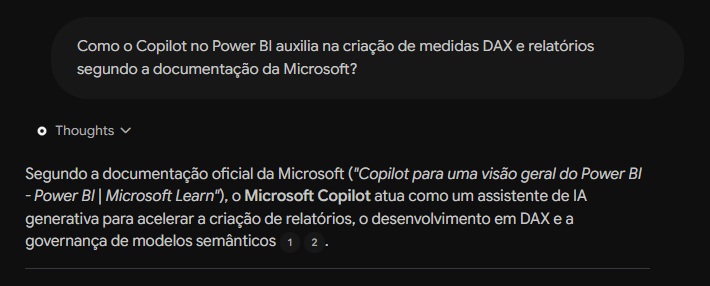
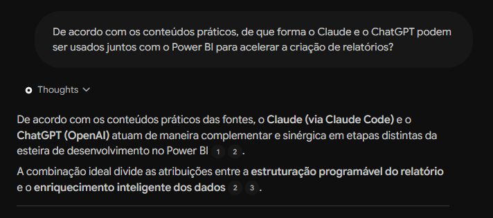
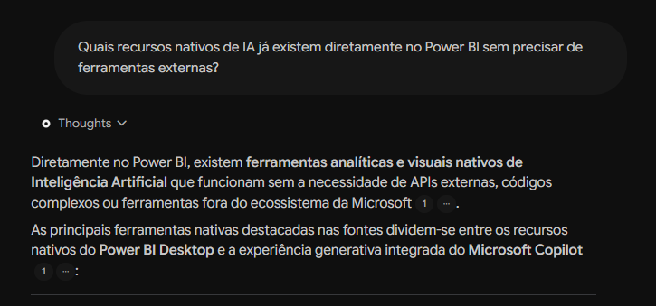

# 🧠 Segundo Cérebro com IA: BI & AI (Power BI + Inteligência Artificial)

> Projeto desenvolvido como parte do Desafio de Projeto da **DIO** com **NotebookLM (Gemini Notebook)**.

---

## 🎯 1. Tema e Objetivo

**Tema:** BI & AI — Combinando Inteligência Artificial com Business Intelligence.  
**Objetivo:** Criar um especialista virtual (Segundo Cérebro) capaz de orientar profissionais e analistas de dados na integração de modelos de IA generativa (Microsoft Copilot, OpenAI ChatGPT e Anthropic Claude) aos fluxos modernos de análise, modelagem e visualização de dados com Power BI, tudo embasado em fontes técnicas, documentações oficiais e casos práticos de negócio.

---

## 📚 2. Fontes Utilizadas e Critérios de Confiabilidade

O caderno foi alimentado por uma curadoria multiformato que combina documentações oficiais dos criadores das tecnologias e conteúdos práticos de especialistas em vídeo:

### 📄 Artigos e Documentações Oficiais (Texto)
1. **Microsoft Learn - Visão geral do Copilot no Power BI:**
   - Link: `https://learn.microsoft.com/pt-br/power-bi/create-reports/copilot-introduction`
   - *Por que é confiável:* Documentação primária da criadora da ferramenta, detalhando arquitetura, pré-requisitos de capacidade Fabric/Premium e criação assistida por IA de relatórios e medidas DAX.
2. **Microsoft Learn - Microsoft Copilot (Ecossistema e Produtividade):**
   - Link: `https://learn.microsoft.com/pt-br/copilot/`
   - *Por que é confiável:* Portal oficial da Microsoft cobrindo diretrizes corporativas, segurança de dados, prompts e governança para uso do Copilot no ecossistema de negócios.
3. **Microsoft Learn - AI Insights no Power Query:**
   - Link: `https://learn.microsoft.com/pt-br/power-bi/transform-model/desktop-ai-insights`
   - *Por que é confiável:* Guia técnico oficial sobre aplicação de inteligência artificial (análise de sentimentos, extração de frases-chave e modelos de Machine Learning) na camada de ETL.
4. **OpenAI Guides - Data Analysis & ChatGPT:**
   - Link: `https://platform.openai.com/docs/guides/data-analysis`
   - *Por que é confiável:* Documentação oficial de referência da criadora do ChatGPT sobre raciocínio analítico, processamento de dados estruturados e automação de código para análise.
5. **Anthropic Claude - Ferramenta de Análise e Execução de Código (Analysis Tool):**
   - Link: `https://claude.com/resources/articles/analysis-tool`
   - *Por que é confiável:* Artigo técnico oficial da Anthropic explicando o funcionamento do ambiente integrado para análise de dados, processamento de planilhas/CSVs e geração de insights com Claude.

### 🎥 Vídeos e Aulas Práticas (YouTube)
1. [Como Usar Claude Code no Power BI | Relatórios no Automático! (Passo a Passo Completo)](https://youtu.be/QqFYvyCOuK0) — *Canal: Gestor Tech | Dados & IA*
   - Ensina a integração prática e automação de relatórios no Power BI utilizando o Claude.
2. [3 Ferramentas INCRÍVEIS de IA Escondidas no Power BI](https://youtu.be/JvpaYmFdtAs) — *Canal: Hashtag Treinamentos*
   - Demonstra recursos nativos de Inteligência Artificial já presentes e pouco explorados dentro da interface do Power BI Desktop.
3. [ChatGPT x Power BI: Tudo que você PRECISA saber e dominar](https://youtu.be/wx6B1yPMlxs) — *Canal: Hashtag Treinamentos*
   - Aborda a sinergia entre ChatGPT e Power BI para aceleração de fórmulas DAX, modelagem de dados e troubleshooting.
4. [IA pra Negócios: Curso Gratuito para Iniciantes em IA](https://youtu.be/eE09THrdjKA) — *Canal: Renato Asse - Instituto Brasileiro de Educação IA*
   - Fundamentos essenciais para aplicar IA no contexto empresarial, métricas e produtividade corporativa.
5. [COMO USAR IA na SUA EMPRESA 🤖 5 DICAS para AUMENTAR PRODUTIVIDADE e LUCRAR MAIS!](https://youtu.be/g0jPisjzRsY) — *Canal: Sebrae PR*
   - Guia prático com foco em negócios e estratégias viáveis para implementação de inteligência artificial gerando valor real.

*Critério de Confiabilidade:* Foco em fontes primárias (Microsoft, OpenAI, Anthropic) para conceitos técnicos e canais renomados para práticas de mercado, garantindo respostas sem alucinações.

---

## ⚙️ 3. Diretriz de Comportamento (System Prompt)

Diretriz configurada no Gemini Notebook:

```text
Você é um Especialista Sênior em Business Intelligence e Inteligência Artificial Aplicada, com foco em Microsoft Power BI, Microsoft Copilot, OpenAI (ChatGPT) e Anthropic (Claude).

Seu papel é atuar como um Segundo Cérebro consultivo para tomada de decisão e análise de dados. Suas respostas devem ser estritamente fundamentadas nas fontes fornecidas (artigos oficiais e vídeos anexados).

Sempre que responder:
1. Explique com profundidade técnica e aplicabilidade prática ao mundo dos negócios;
2. Destaque de qual fonte, artigo ou vídeo a recomendação foi extraída;
3. Se algo não estiver coberto pelas fontes, declare com transparência em vez de especular.
```

---

## 💬 4. Conversando com as Fontes (Perguntas & Citações)

### Pergunta 1:
> *"Como o Copilot no Power BI auxilia na criação de medidas DAX e relatórios segundo a documentação da Microsoft?"*
- **Síntese da Resposta do Notebook:** O Copilot atua transformando descrições em linguagem natural em medidas DAX válidas, além de criar páginas completas de relatórios sugerindo automaticamente visuais e cartões analíticos coerentes com o modelo de dados.
- **Fonte(s) Citada(s):** `Microsoft Learn: Visão geral do Copilot no Power BI`.



### Pergunta 2:
> *"De acordo com os conteúdos práticos, de que forma o Claude e o ChatGPT podem ser usados juntos com o Power BI para acelerar a criação de relatórios?"*
- **Síntese da Resposta do Notebook:** O ChatGPT e o Claude atuam como co-pilotos para acelerar a formulação de scripts em linguagem M (Power Query) e DAX complexos, documentação automática de métricas e até geração de código para automatizar layouts de visualização, diminuindo drasticamente o tempo manual de desenvolvimento.
- **Fonte(s) Citada(s):** Vídeos: `Como Usar Claude Code no Power BI (Gestor Tech)` e `ChatGPT x Power BI (Hashtag Treinamentos)`.



### Pergunta 3:
> *"Quais recursos nativos de IA já existem diretamente no Power BI sem precisar de extensões externas?"*
- **Síntese da Resposta do Notebook:** O Power BI conta com recursos nativos como Decomposição de Árvore (Decomposition Tree), Principais Influenciadores (Key Influencers), Narrativa Inteligente (Smart Narrative) e detecção de anomalias em gráficos de linha.
- **Fonte(s) Citada(s):** `3 Ferramentas INCRÍVEIS de IA Escondidas no Power BI (Hashtag Treinamentos)` e `Microsoft Learn - AI Insights`.



---

## 📦 5. Materiais Gerados no Estúdio (Artifacts)

A partir da síntese do Gemini Notebook, foram organizados os seguintes materiais:
- [x] **Guia de Estudos e Glossário:** Documento de síntese conceitual sobre BI & IA (salvo em [docs/guia-de-estudos-bi-ai.md](docs/guia-de-estudos-bi-ai.md)).
- [x] **Resumo Executivo para Negócios:** Guia de implementação de IA para analistas e gestores (salvo em [docs/resumo-executivo-ia-negocios.md](docs/resumo-executivo-ia-negocios.md)).
- [x] **Resumo em Áudio (Deep Dive):** Áudio exportado do Estúdio debatendo os temas (salvo em [audio/resumo-notebook-bi-ai.m4a](audio/resumo-notebook-bi-ai.m4a)).
- [x] **Evidências Visuais:** Capturas do chat comprovando a ancoragem e citações das fontes (salvas em `/evidencias`).

---

## 🔗 6. Link do Notebook Compartilhado

🔗 **Acesse o Gemini Notebook deste projeto:**  
[https://notebook.google.com/notebook/4e254cad-cb90-4ddd-b91d-8051c1076296](https://notebook.google.com/notebook/4e254cad-cb90-4ddd-b91d-8051c1076296)

---

## 📋 Checklist de Entrega
- [x] Respostas no README com referências explícitas às fontes adicionadas.
- [x] Imagens das evidências do chat incorporadas diretamente no README.
- [x] Fontes verificadas, sem dados pessoais ou proprietários restritos.
- [x] Repositório público com nome legível em minúsculas (`desafio-bi-ai-segundo-cerebro`).
- [x] Áudio em formato M4A gerado pelo Estúdio devidamente incluído no projeto.


