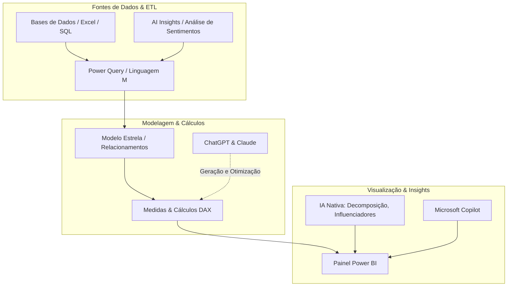

# Guia de Estudos: BI & IA com Power BI, Claude e ChatGPT

Este guia sintetiza os conceitos fundamentais explorados no Segundo Cérebro especializado em **Business Intelligence & Inteligência Artificial**.

---

## 📌 Glossário Técnico Essencial

| Termo | Definição no Contexto de BI & IA |
|---|---|
| **DAX (Data Analysis Expressions)** | Linguagem de fórmulas utilizada no Power BI, Analysis Services e Power Pivot no Excel. A IA atua na aceleração e otimização dessas fórmulas. |
| **Linguagem M** | Linguagem funcional utilizada no Power Query do Power BI para tratamento, limpeza e transformação de dados (ETL). |
| **Copilot no Power BI** | Assistente de IA generativa integrado da Microsoft que gera páginas de relatórios, resumos em linguagem natural e medidas analíticas a partir de prompts. |
| **LLMs (Large Language Models)** | Modelos como GPT (OpenAI) e Claude (Anthropic) capazes de raciocínio, geração de código e interpretação de dados estruturados e não-estruturados. |
| **Key Influencers (Principais Influenciadores)** | Visual de IA nativo do Power BI que analisa fatores determinantes para um KPI subir ou descer através de regressão logística/linear automática. |
| **Decomposition Tree (Árvore de Decomposição)** | Visual nativo com IA que permite explorar dimensões detalhadas (drill-down) escolhendo automaticamente os valores mais altos ou baixos. |
| **Smart Narrative (Narrativa Inteligente)** | Visual nativo do Power BI que gera texto automatizado resumindo os principais insights e variações dos gráficos na tela. |

---

## 🧠 Sinergia entre as Ferramentas

---

## 🚀 Boas Práticas para o Analista de Dados Moderno

1. **Validação Humana (Human-in-the-loop):** Nunca suba uma medida DAX ou script M gerado por IA sem validar o contexto de filtro (*Filter Context*) e a consistência dos totais.
2. **Privacidade e Governança:** Atenção ao enviar dados de clientes para ferramentas de chat públicas; use versões corporativas ou anonimize as informações antes do prompt.
3. **Engenharia de Prompt para BI:** Ao pedir ajuda a um LLM (ChatGPT ou Claude), forneça sempre o nome exato das tabelas, tipos de dados das colunas e o objetivo da regra de negócio.
